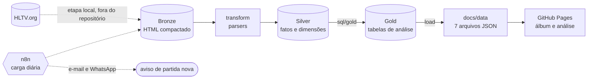

# FURIA em dados: esteira em arquitetura medalhão

Organiza o histórico de partidas de CS da FURIA, registrado pela [HLTV](https://www.hltv.org), em três camadas prontas para alimentar um dashboard. Tudo roda localmente, só com ferramentas gratuitas. Projeto de fã, sem fins comerciais e sem vínculo com a HLTV ou com a FURIA; veja [Sobre os dados e a HLTV](#sobre-os-dados-e-a-hltv).

| Camada | O que guarda | Onde |
|---|---|---|
| **Bronze** | HTML bruto de cada página de partida, compactado e guardado como veio | `data/bronze/**/*.html.gz` |
| **Silver** | Modelo estrela (fatos e dimensões), na ótica da FURIA | `data/furia.duckdb`, schema `silver` |
| **Gold** | Tabelas agregadas e tabelas no grão de mapa para o dashboard | schema `gold`; as que o site usa vão para `docs/data/*.json` |

O caminho de uma partida, da página da HLTV até o site:



Como a bronze guarda o HTML original, corrigir ou ampliar o que é lido não exige buscar nada de novo: basta `python main.py reconstruir`.

## Modelo de dados

**Silver**, dimensões: `dim_time`, `dim_jogador`, `dim_evento`, `dim_mapa`. Fatos:

| Tabela | Grão |
|---|---|
| `fato_partida` | uma linha por partida (série) |
| `fato_mapa` | uma linha por mapa jogado, com rounds por lado (CT/TR) e prorrogação |
| `fato_veto` | uma linha por ação de veto (ban, pick, mapa que sobrou) |
| `fato_jogador_mapa` | uma linha por jogador × mapa × lado (TOTAL, CT, TR) |
| `fato_colocacao_evento` | uma linha por campeonato com colocação final |

**Gold**, tabelas agregadas: `kpis_gerais`, `partidas`, `desempenho_mensal`, `confronto_direto`, `confronto_por_mapa`, `placares`, `desempenho_por_evento`, `desempenho_por_mapa`, `desempenho_por_mapa_ano`, `vetos`, `jogadores`, `jogador_por_mapa`, `jogador_por_lado`, `jogador_mensal`.

Além das agregadas, a gold tem a tabela `lineups` (uma linha por escalação) e quatro tabelas de detalhe (`detalhe_mapas`, `detalhe_jogadores`, `detalhe_jogadores_lado` e `detalhe_vetos`), que o dashboard filtra e recalcula no navegador. As tabelas agregadas são a referência em SQL: o site refaz as mesmas contas em JavaScript por causa dos filtros, e os testes conferem que os dois lados batem.

As transformações estão em SQL puro, em [`sql/silver`](sql/silver) e [`sql/gold`](sql/gold).

## Dashboard

**https://jpgso.github.io/furia-hltv-pipeline/**

Site estático em [`docs/`](docs), servido pelo GitHub Pages:

- `index.html`: o álbum. A formação atual em figurinhas, uma figurinha para cada partida da história, uma página para cada formação que passou de 50 partidas, a trajetória de rating dos jogadores e a prateleira de campeonatos.
- `analise.html`: a análise completa, em abas: resumo (com calendário), mapas (CT contra TR e lado inicial), jogadores, vetos, adversários, jogos grandes, placares, campeonatos e partidas.

A análise tem filtros de período, formação, mapas, jogador, adversário, ambiente e formato, e recalcula tudo no navegador conforme o recorte. Nas duas páginas, cheio é vitória e vazado é derrota. O código comum fica em `comum.js` e `comum.css`; cada página tem o seu script (`index.js`, `analise.js`). Os gráficos são desenhados com HTML, CSS e SVG, sem biblioteca externa, e uma política de segurança de conteúdo (CSP) só permite scripts do próprio site. As páginas carregam os arquivos com `?v=<versão>`; ao mudar o visual ou os scripts, troque esse número para o navegador não misturar arquivos novos com antigos em cache.

Os dados ficam em `docs/data/`: a cada execução a esteira copia para lá as tabelas gold que o site usa. Com `--publicar`, ela também faz o commit dessa pasta e o push; o GitHub Pages atualiza o site em seguida. Só há commit quando algum dado mudou.

```bash
python main.py --publicar
```

Para ver o site localmente:

```bash
python -m http.server 8765 --directory docs
```

## Como executar

1. Instale as dependências:

   ```bash
   pip install -r requirements.txt
   ```

2. Rode a esteira sobre a bronze guardada em `data/bronze`:

   ```bash
   python main.py               # lê o que há de novo na bronze e atualiza silver, gold e docs/data
   python main.py reconstruir   # reinterpreta toda a bronze do zero
   ```

A esteira começa no HTML já guardado no disco. A etapa que abastece a bronze roda só na máquina do autor e não faz parte deste repositório, assim como a pasta `data/`. Sem a bronze, dá para ver o projeto funcionando pelos testes, que montam uma bronze de exemplo, e pelo site, que usa os dados de `docs/data/`.

## Atualização automática com n8n (opcional)

O fluxo em [`n8n/workflow_furia_diario.json`](n8n/workflow_furia_diario.json) roda a carga diária em segundo plano e avisa por WhatsApp e e-mail quando há partida nova ou quando algo precisa de atenção. Ele dispara a cada inicialização do n8n e uma vez por dia, às 21h. Como o n8n sobe junto com o Windows (passo 6), ligar o computador já atualiza os dados e o dashboard; o horário fixo cobre os dias em que a máquina fica ligada.

O n8n precisa rodar **na mesma máquina** da esteira, instalado via Node.js (no Docker ele não alcança o Python nem os arquivos locais).

1. Instale o [Node.js 22](https://nodejs.org/dist/latest-v22.x/) (arquivo `-x64.msi`) e depois o n8n. Em versões mais novas do Node, como a 26, a instalação do n8n falha por falta de binários prontos de uma dependência:

   ```bash
   npm install -g n8n
   ```

2. Inicie o n8n liberando o nó *Execute Command*, que vem bloqueado por padrão nas versões 2.x (PowerShell). Abra `http://localhost:5678` e crie a conta local:

   ```powershell
   $env:NODES_EXCLUDE = "[]"; n8n.cmd start
   ```

3. Importe o fluxo (menu do editor → *Import from File*) e ajuste o nó **Configuracao**: pasta do projeto, telefone com código do país e e-mails.

4. Credenciais (ficam só no seu n8n, nunca neste repositório):
   - **WhatsApp (CallMeBot)**: ative o serviço para o seu número seguindo as instruções em [callmebot.com](https://www.callmebot.com) (API de WhatsApp) e, no nó, crie uma credencial *Query Auth* com nome `apikey` e a chave recebida. É um serviço gratuito de terceiros, para uso pessoal.
   - **E-mail**: credencial *SMTP*. No Gmail: host `smtp.gmail.com`, porta 465, SSL, usuário = seu e-mail e uma [senha de app](https://myaccount.google.com/apppasswords).

5. Teste com *Execute workflow* e depois ative o fluxo.

6. Para o n8n subir junto com o Windows (PowerShell, uma única vez):

   ```powershell
   $acao = New-ScheduledTaskAction -Execute "powershell.exe" -Argument '-NoProfile -WindowStyle Hidden -Command "$env:NODES_EXCLUDE=''[]''; $env:N8N_LISTEN_ADDRESS=''127.0.0.1''; n8n.cmd start"'
   $gatilho = New-ScheduledTaskTrigger -AtLogOn -User $env:USERNAME
   $config = New-ScheduledTaskSettingsSet -AllowStartIfOnBatteries -DontStopIfGoingOnBatteries -ExecutionTimeLimit ([TimeSpan]::Zero)
   Register-ScheduledTask -TaskName "n8n" -Action $acao -Trigger $gatilho -Settings $config
   Start-ScheduledTask -TaskName "n8n"
   ```

   Assim o n8n roda escondido, sem depender de uma janela do PowerShell aberta. `N8N_LISTEN_ADDRESS` restringe o acesso ao próprio computador, o que importa porque o nó *Execute Command* está liberado.

O fluxo chama um script local de carga, que não faz parte deste repositório, e lê o resumo que ele grava em `data/ultima_execucao.json`: uma linha de JSON com `status` e as partidas novas. A leitura é feita com `type`, porque no Windows o nó *Execute Command* não captura a saída de programas filhos. Quando algo precisa de atenção, o aviso chega uma vez (no máximo um por dia para o mesmo problema) e a execução seguinte continua de onde parou.

## Estrutura

```
docs/        dashboard publicado no GitHub Pages (páginas e dados)
n8n/         fluxo de atualização automática (importável no n8n)
config/      caminhos, parâmetros e logging
transform/   leitura do HTML em registros (parsers)
load/        leitura da bronze (bronze), banco DuckDB, execução do SQL e exportação da gold (warehouse); publicação do dashboard (publish)
sql/         transformações silver e gold
tests/       testes dos parsers e da construção das camadas
```

## Testes

```bash
python -m pytest tests -q
```

Além dos parsers e das camadas, um teste roda as agregações do dashboard (`docs/comum.js`) no Node sobre os dados de exemplo e compara com as tabelas gold: o que o site calcula no navegador tem de bater com o SQL. Sem Node instalado, esse teste é pulado.

Os testes também rodam no GitHub Actions a cada push.

## Observações sobre os dados

- Datas e horas estão no horário de Brasília, incluindo o horário de verão que existiu até 2019.
- Estatísticas "eco-adjusted" (eK-eD, eADR, eKAST) e Swing só existem nas partidas mais recentes; nas antigas ficam nulas.
- O rating mistura versões da HLTV (2.0 nas partidas antigas, 3.0 nas novas); a coluna `rating_versao` identifica cada linha.
- O mapa `Default` (vantagem de mapa ou W.O.) conta no placar da série, mas fica fora das estatísticas por mapa (`sem_disputa`).
- Título é a colocação `1st`; faixas como `1-2nd` não contam como título.
- LAN ou online só é informado pela HLTV em parte das partidas, quase todas de 2021 em diante; nas demais o campo fica nulo.
- Fonte dos dados: HLTV.org. O conteúdo bruto (`data/`) não é versionado neste repositório; só as tabelas que o dashboard usa (`docs/data/`).

## Sobre os dados e a HLTV

- Projeto de fã, pessoal e de estudo. Não tem vínculo com a HLTV.org nem com a FURIA.
- Não tem fins comerciais: sem anúncio, sem venda, sem monetização de qualquer tipo.
- As estatísticas, o rating e as colocações são da [HLTV.org](https://www.hltv.org), que é a fonte e a dona desse conteúdo. Cada partida do site leva de volta à página original.
- Este repositório não traz ferramenta de coleta nem o conteúdo bruto das páginas. Ele cobre a modelagem dos dados e o site.
- Remoção a pedido: se a HLTV ou qualquer titular de direitos quiser que os dados ou o projeto saiam do ar, basta abrir uma [issue](https://github.com/jpgso/furia-hltv-pipeline/issues) e isso será feito.

## Licença

O código está sob a [licença MIT](LICENSE). Os dados pertencem à HLTV.org e não são cobertos por ela; o uso deles aqui é pessoal e não comercial.
